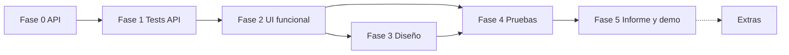

# PLANNING — Panel de administración de servidores dinámicos

Taller S11 · Redes Masivas de Servidores · Universidad de Cundinamarca.

a firebase **NO subir archivos .env** ni mucho menos mostrarlos en frontend
## app name
AetherRoute **Nombre sugerido para la app**

## 1. Objetivo

Una página web que consuma el balanceador (`balanceador.py`) y los 3 servidores (`servidores.py`), muestre su estado en vivo y pase las 6 pruebas funcionales del PDF, con evidencias y demo en vivo.

**Entregables obligatorios (PDF §5):** `index.html`, `estilos.css`, `script.js`, interfaz conectada a la API, evidencias de pruebas, demo en vivo e informe final.

## 2. Decisiones a confirmar antes de empezar

| # | Tema | Situación | Recomendación |
|---|------|-----------|---------------|
| D1 | "No modificar ni reconstruir la API" (PDF §3) vs. "pulir los 2 `.py`" | La API actual **no arranca** (ver §3). | Solo correcciones mínimas que conserven rutas y formas JSON. Todo lo nuevo va en archivos aparte. Mencionarlo en el informe como "correcciones", no "reconstrucción". |
| D2 | React + Tailwind vs. HTML/CSS/JS | El PDF exige explícitamente los 3 archivos `index.html`, `estilos.css`, `script.js`. | Entregable en **HTML/CSS/JS puro**. React/Tailwind solo como versión extra si sobra tiempo (§9); no sustituye la entrega. |
| D3 | Demo local y Hosting | **Resuelto por Raven:** la entrega y las pruebas del PDF se ejecutan en cada equipo desde un clon, sin Firebase ni `.env`. | `README.md` documenta arranque local; Hosting y un backend HTTPS se posponen y no bloquean la entrega. |
| D4 | Base de datos | Hoy `historial` vive en memoria y se pierde al reiniciar. | SQLite en un módulo opcional separado (§9), sin tocar el contrato de la API. |
| D5 | Cloudinary | Es almacenamiento de archivos, no una base de datos. | Úsalo solo para **evidencias** (capturas, JSON de pruebas), subidas desde backend (§9). |

## 3. Diagnóstico de los `.py`

### `balanceador.py` — no arranca ni responde

| Línea | Problema | Corrección |
|-------|----------|------------|
| 50 | Ruta `/Servidores`; el PDF pide `GET /servidores` | Renombrar a `/servidores` |
| 66 | `resultado.append` → `NameError` (la lista es `resultados`) | Unificar nombre |
| 73 | `total_servidores` sin comillas → `NameError` | `"total_servidores"` |
| 89 | `cliente` → `NameError` (es `client`) | Corregir |
| 89–100 | Si `/health` no es 200, `respuesta` queda sin definir; si `/procesar` falla, el bucle sigue sin avisar | Anidar la llamada y continuar al siguiente servidor |
| 105 | `raise HTTPException` está **fuera de la función** (módulo): lanza al importar | Indentarlo dentro de `solicitar` |
| 22–34 | URLs `127.0.1.1` pero `servidores.py` escucha en `127.0.0.1` → conexión rechazada | Usar `127.0.0.1` |
| 76 | Llama `/procesar`; `servidores.py` expone `/Procesar` → 404 | Minúscula en ambos (coherente con `/health`) |
| 14 | `allow_origins=["*"]` con `allow_credentials=True`: combinación inválida para navegadores | `allow_credentials=False` |
| 39 | `historial` crece sin límite | `deque(maxlen=…)` o límite fijo |

### `servidores.py`

| Línea | Problema | Corrección |
|-------|----------|------------|
| 28 | `/Procesar` en mayúscula | `/procesar` |
| 11–14 | `argparse` a nivel de módulo: no se puede importar ni testear | Moverlo a `main()` o leer `os.environ` con valores por defecto |
| 19–31 | `contador += 1` sin protección (los endpoints `def` corren en hilos) | `threading.Lock` |
| 4 | `import sys` sin uso | Eliminar |

### Contrato a conservar (el frontend depende de él)

```
GET /                → {Sistema, servidores_configurados, Solicitudes_envidadas, mensaje}
GET /servidores      → {total_servidores, servidores:[{nombre,url,puerto,estado:"Activo"|"Inactivo"}]}
GET /solicitar       → {servidor, puerto, mensaje, contador, resultado}   | 503 {detail}
GET /estadisticas    → {total_solicitudes, Solicitudes_por_servidor:{nombre:n}}
```

Los nombres con mayúscula o errata (`Solicitudes_por_servidor`, `Solicitudes_envidadas`) **no se renombran**: se documentan y el frontend los lee tal cual.

## 4. Estructura propuesta

```
servidores/
├─ balanceador.py        # corregido
├─ servidores.py         # corregido
├─ requirements.txt      # fastapi, uvicorn, httpx (+ pytest en dev)
├─ scripts/
│  ├─ iniciar.sh         # 3 servidores + balanceador
│  └─ detener.sh         # mata por puerto (para pruebas 3 y 5)
├─ tests/                # pytest
├─ web/
│  ├─ index.html
│  ├─ estilos.css
│  ├─ script.js
│  └─ assets/icons/      # copia de los iconos usados
├─ evidencias/           # capturas y logs de cada prueba
├─ extras/               # opcional: SQLite, Cloudinary (§9)
└─ PLANNING.md
```

Hay dos entornos (`venv/` y `.venv/`) con muchos paquetes ajenos. Usar uno solo y documentar `requirements.txt` mínimo.

## 5. Fases

### Fase 0 — Entorno y API funcionando

- [x] Usar `.venv` y fijar `requirements.txt` (FastAPI, httpx y uvicorn).
- [x] Aplicar las correcciones de §3 en ambos `.py`.
- [x] `scripts/iniciar.sh`: lanza puertos 8001–8003 y el balanceador en 8000; `detener.sh` detiene uno o todos por puerto.
- [x] Verificar con `curl` los 4 endpoints del contrato.

**Listo cuando:** `curl /solicitar` ×6 rota 1→2→3→1→2→3 y `/estadisticas` suma 6.

### Fase 1 — Pruebas de la API

- [x] `pytest` + `httpx` contra el sistema levantado:
  - Rotación round-robin y contadores.
  - Un servidor caído se omite y `/servidores` lo marca `Inactivo`.
  - Todos caídos → `503` con `detail`.
  - Servidor que vuelve → se reincorpora.
- [x] Verificar CORS desde `http://localhost:5500` y desde `file://` (origen `null`).

**Listo cuando:** los tests pasan y cubren las pruebas 2, 3, 5 y 6 del PDF a nivel API.

### Fase 2 — Interfaz funcional (sin pulido visual)

HTML semántico + `script.js` conectado. Prioridad: que todo funcione y se pueda probar.

- [x] `API_BASE` en una constante al inicio de `script.js` (por defecto `http://127.0.0.1:8000`).
- [x] Helper único `api(ruta)` con `fetch`, `AbortController` (timeout ~3 s) y errores normalizados:

  | Causa | Mensaje para el usuario |
  |-------|-------------------------|
  | `TypeError` / timeout | La API no responde. Verifica que el balanceador esté en ejecución. |
  | HTTP 503 | No hay servidores disponibles. |
  | Otro HTTP no OK | La petición falló (HTTP *n*). |
  | Fallo solo en estadísticas | No se pudieron cargar las estadísticas. |

- [x] Resumen: `total_solicitudes` y `total_servidores`.
- [x] Tabla de servidores: nombre, puerto, estado (activo/inactivo diferenciado por color **y** texto/icono); botón **Actualizar**.
- [x] Botón **Enviar solicitud** (nombre exigido): muestra servidor que atendió, `contador` y `resultado`; tras responder, refresca estadísticas (y servidores).
- [x] Estadísticas: barras de progreso por servidor; incluir con 0 los servidores sin solicitudes (cruzando con `/servidores`).
- [x] Área de mensajes (éxito/error) con marca de hora; máximo ~20 entradas.
- [x] Deshabilitar botones mientras hay una petición en curso (evita dobles envíos).
- [x] Pintar datos con `textContent`, nunca `innerHTML` con datos de la API.

**Listo cuando:** las 6 pruebas del PDF se pueden ejecutar a mano desde el navegador.

### Fase 3 — Diseño (Hermes)

Fuente: `hermes_desktop_desing/`. Es **inspiración**, no código a copiar.

**Hallazgos sobre los recursos**
- `hermes-design-tokens.css` está corrupto: tiene nombres de tokens pero **sin valores**. Hay que definir los valores propios.
- `icons/` (48 PNG): útiles `refresh-cw`, `check-circle`, `x-circle`, `alert-triangle`, `bar-chart`, `list`, `info`, `sun`, `moon`, `globe`, `rocket`, `settings`. No hay icono de servidor. Si son monocromos, usarlos con `mask-image` para que tomen el color del tema; si no, descartar los que no encajen.
- No existe carpeta `fuentes/`: usar pila de sistema (`system-ui`, `ui-monospace`) o autoalojar una fuente con licencia abierta.
- No usar el `BrandMark` ni el nombre Hermes: la identidad es propia.

**Tareas**
- [x] Tokens en `estilos.css` con los nombres de `DESIGN.md` (`--ui-text-primary/secondary/tertiary`, `--ui-stroke-tertiary`, `--ui-bg-quaternary`, `--ui-accent`, `--shadow-nous`, `--stroke-nous`), valores para claro y oscuro.
- [x] Tema: `prefers-color-scheme` por defecto + botón sol/luna; guardar preferencia en `localStorage`.
- [x] Principios a aplicar: plano (sin tarjeta dentro de tarjeta), separación con espacio y un solo hairline, sin colores literales fuera de los tokens, un único estilo de botón con variantes.
- [x] **Skeleton** en tarjetas, tabla y barras mientras llega la primera respuesta (nunca el texto "Cargando…").
- [x] **Shimmer** en los skeletons (gradiente animado con `transform`/`background-position`).
- [x] **Ambient lighting:** 2–3 resplandores radiales de baja opacidad detrás del contenido, deriva lenta; el color puede reflejar el estado (verde: todos activos, ámbar: parcial, rojo: ninguno).
- [x] Contadores numéricos con animación breve; barras con transición de ancho.
- [x] Transiciones de ~100 ms en controles; listar propiedades, **sin `transition-all`**.
- [x] `prefers-reduced-motion`: desactivar shimmer, ambient y contadores animados.
- [x] Estados vacío y error con un único componente visual cada uno.
- [x] Accesibilidad: foco visible, contraste AA, `aria-live="polite"` en mensajes, estados no dependientes solo del color.
- [x] Responsive: 360 px → escritorio.

**Textos (reglas)**
- El `<h1>` es el título exigido por el PDF: *Panel de administración de servidores dinámicos*. Es el único lugar donde aparece la frase completa.
- Ningún encabezado repite una palabra del `<h1>` ni de otro encabezado. Ejemplo orientativo: tarjetas **Atendidas** / **Configurados**; tabla **Estado**; acción **Enviar solicitud**; barras **Reparto**; mensajes **Eventos**.
- Descripción de una sola línea. Sin párrafos explicativos ni subtítulos que repitan el título de la sección.

**Listo cuando:** claro/oscuro correctos, skeletons visibles en red lenta, sin animación con `reduced-motion`, Lighthouse accesibilidad ≥ 90.

### Fase 4 — Pruebas funcionales y evidencias

| # | Prueba (PDF §4) | Procedimiento | Evidencia |
|---|-----------------|---------------|-----------|
| 1 | Consultar servidores | Cargar la página con los 3 activos | `evidencias/01-servidores.png` |
| 2 | 5 solicitudes | Pulsar **Enviar solicitud** ×5 | `02-solicitudes.png` + cuál atendió cada una |
| 3 | Detener un servidor | `detener.sh 8002` → **Actualizar** | `03-servidor-inactivo.png` |
| 4 | Estadísticas cambian | Comparar antes/después de enviar | `04-estadisticas.png` (dos capturas) |
| 5 | Sin servidores | Detener los 3 → enviar solicitud | `05-sin-servidores.png` |
| 6 | Recuperación | Reiniciar servidores → **Actualizar** | `06-recuperacion.png` |

- [ ] Repetir en tema claro y oscuro al menos una vez.
- [ ] Probar con la API apagada (mensaje "La API no responde").
- [ ] Guardar la salida de `pytest` en `evidencias/`.

### Fase 5 — Informe y demo

- [ ] Informe: arquitectura (diagrama), correcciones a los `.py` y por qué, decisiones de diseño, tabla de pruebas con evidencias, problemas y soluciones.
- [ ] Guion de demo de 5 min: iniciar → solicitudes → detener uno → detener todos → recuperar.
- [ ] Ensayo completo desde un clon en otra máquina del grupo siguiendo `README.md` (arranque, seis pruebas visuales y parada).

## 6. Buenas prácticas

**Python**
- Type hints en funciones públicas; `ruff` (lint + format).
- Comentarios y docstrings de **una línea**, solo para explicar el porqué.
- Nombres coherentes en español, como el resto de la API.
- Sin estado global innecesario; sin `print` (usar `logging`).
- Dependencias fijadas en `requirements.txt`.

**JavaScript**
- `const`/`let`, funciones pequeñas con una responsabilidad, sin variables globales sueltas (un objeto `estado`).
- Sin `onclick` en el HTML: `addEventListener`.
- `async/await` con `try/catch` en un solo punto de entrada de errores.
- Sin datos inventados: todo viene de la API; si no hay dato, estado vacío.
- Polling opcional (~5 s) solo con la pestaña visible (`document.visibilityState`).

**CSS**
- Variables para color, espacio, radio, sombra y duración. Sin `!important`.
- Una sola clase de botón con modificadores.

**Git**
- Commits pequeños por fase; no subir `venv/`, `.venv/`, `__pycache__/`, `.env`.
- Crear `.gitignore` en Fase 0.

## 7. Riesgos

| Riesgo | Mitigación |
|--------|------------|
| Chrome pide permiso de "red local" cuando una página HTTPS (Firebase) llama a `127.0.0.1` | Demo siempre local con `python -m http.server 5500` en `web/` |
| Contenido mixto (HTTPS → HTTP) en la copia de Firebase | Solo válida si la API se despliega con HTTPS (Cloud Run/Render); si no, documentarla como vista previa sin datos |
| `file://` envía origen `null` | CORS `*` lo cubre; aun así servir por HTTP |
| Cambiar la API y que el docente lo considere "reconstruir" | Documentar cada corrección (§3) y no cambiar el contrato |
| Puertos ocupados | `iniciar.sh` verifica y avisa |

## 8. Orden de ejecución



La Fase 3 puede ir en paralelo con la 4 solo después de que la 2 funcione. **No empezar diseño hasta cerrar Fase 0 y 1.**

## 9. Extras (después de entregar lo obligatorio)

- **Registro de peticiones (SQLite):** app aparte en `extras/` (puerto 8010). El frontend envía cada resultado a `POST /registro`. Tabla `peticion(id, servidor, puerto, contador, ok, ts)`. No modifica `balanceador.py`.
- **Cloudinary:** el backend extra firma la subida; el *API secret* vive en `.env`, nunca en el navegador. Subir capturas de `evidencias/` y el JSON del registro (`resource_type=raw`).
- **Firebase Hosting:** `firebase init hosting` con `public = web`; `API_BASE` configurable por `?api=` o `config.js`.
- **React + Tailwind:** versión paralela en `web-react/` (Vite). Solo si el equipo lo decide; reutiliza los mismos tokens.
- **Control de procesos desde la UI** (iniciar/detener servidores): cambia el alcance de la API; no hacerlo sin autorización del docente.
